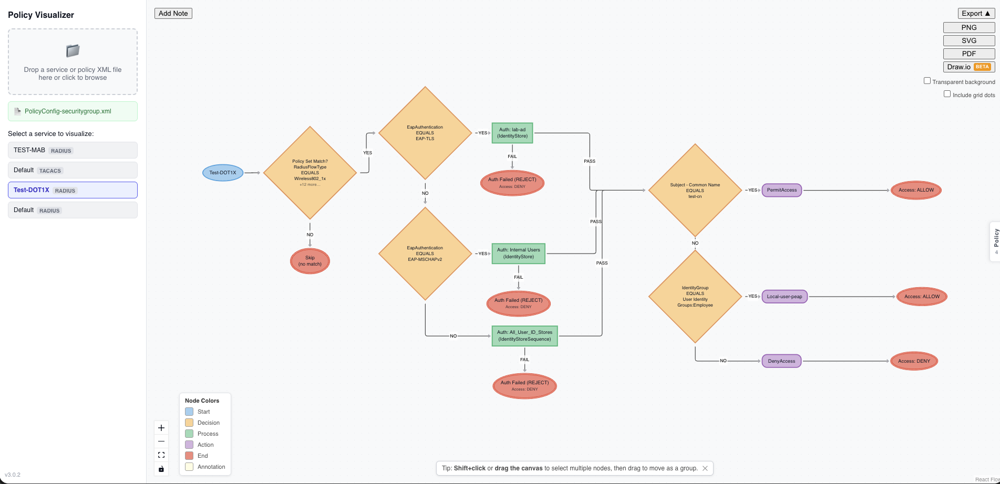

Policy Visualizer converts a network policy XML service export (or a ClearPass DB backup) into:

- a normalized policy model,
- a compiled decision-flow graph,
- and an interactive browser diagram.

**Current release:** v4.0.0-beta.2 (pre-release) · Last GA: v3.3.3



## What it does

- Parses **Aruba ClearPass** and **Cisco ISE** service export XML (RADIUS + TACACS); format is auto-detected on upload
- Also reads a **ClearPass DB backup** (`tipsdb` `.pgdump`), which adds true service evaluation order and every configured object (see [ClearPass DB backups](#clearpass-db-backups-pgdump))
- Normalizes policy conditions into canonical Boolean expressions
- Builds deterministic Policy IR and Flow IR
- Serves Flow IR from a FastAPI backend
- Renders an interactive flow diagram in a React Flow frontend with WYSIWYG annotation support
- Surfaces full rule conditions and actions in a Policy Details side panel (click any decision or action node), including each enforcement profile's attributes (e.g. Aruba-User-Role, VLAN); with nothing selected it shows a service summary (template, enabled/monitor mode, auth, policies)
- Shows key profile attributes (role / VLAN / filter) directly under enforcement action nodes
- Searches the diagram (node labels, conditions, profile names and attribute values) with next/previous navigation
- Service picker shows disabled services and template badges. With a DB backup it lists services in ClearPass evaluation order, with "------Name------" divider services as section headers (an XML export doesn't carry that order, so dividers are hidden)
- **Configuration report**: where each policy, profile, role, auth method and source is used, and which objects nothing uses (complete only for DB backups, since XML exports omit unreferenced objects)
- **Coverage report**: anonymous feature counts (templates, profile types, condition operators, uninterpreted settings) with no names or values, safe to share to help prioritise support
- Exports diagrams to PNG, SVG, PDF, and Draw.io format (BETA)
- Exports PDF with optional policy details appendix (service settings, rule tables, conditions, actions, profile attributes)
- Builds new policies interactively in the **Policy Builder** tab (v4.0.0-beta.2): connect to a live ClearPass appliance, browse policy elements, compose rules on a canvas, and preview the resulting flow diagram
- Supports static SVG/PNG/PDF generation via CLI (ClearPass only; offline/scripted use)

## Policy Builder (v4.0.0-beta.2)

The **Build** tab connects directly to a live ClearPass REST API to browse existing policy elements (roles, profiles, enforcement policies, auth sources) and build a new service from scratch on an interactive canvas. A **Preview** button compiles the canvas state to a flow diagram without writing back to the appliance.

- Credential entry (host, client ID/secret) sent per-request — no server-side credential storage
- Element library with drag-to-canvas support
- Condition builder (AND/OR predicates) and rule editor
- Template loader (pull an existing service from the appliance as a starting point)

**Note:** ISE support in the Builder is deferred to a later release. Write-back to the appliance (Phase 2) is also deferred to v4.0.0 GA.

## ClearPass DB backups (.pgdump)

Besides XML exports, you can upload the `tipsdb` PostgreSQL dump (custom format, `.pgdump`) from a ClearPass configuration backup. It produces the same diagrams as the XML export of the same appliance, and adds:

- **Evaluation order**: services are listed in the order ClearPass evaluates them. XML exports are grouped by service type instead.
- **Every configured object**, including profiles and roles no service uses, so the Configuration report can list them.
- Profile types an XML export can't carry: **SNMP** and **Agent** enforcement profiles and **Downloadable User Role** settings.

What is read, and what isn't:

- Only an allow-list of policy tables and columns is read (`src/pgdump_reader.py`). The backup's secret-bearing tables (local and admin users, NAD shared secrets, certificates, auth-source credentials) are never extracted.
- Literal values of secret-looking profile attributes (passphrases, passwords, PSKs, keys) are shown as `(hidden)`, the way ClearPass blanks them in XML exports.
- Nothing is stored: the upload is written to a temporary file for `pg_restore` and deleted straight after.

Reading a backup needs `pg_restore` from the PostgreSQL client tools. The Docker image includes it. For local development, install it with `brew install libpq` or `apt install postgresql-client`, or point `PG_RESTORE` at the binary. No database server is needed. The upload limit for backups is 100 MB; change it with `PV_MAX_PGDUMP_MB`, and keep nginx's `client_max_body_size` in step.

## Tech Stack

- **Backend/API:** FastAPI, defusedxml
- **Compiler pipeline:** Python — ClearPass (`src/parser.py`, `src/normalizer.py`, `src/policy_ir.py`, `src/flow_ir.py`) and Cisco ISE (`src/ise_parser.py`, `src/ise_normalizer.py`, `src/ise_policy_ir.py`, `src/ise_flow_ir.py`)
- **Frontend:** React + Vite + React Flow + Dagre + Tiptap
- **Packaging:** Docker + docker-compose
- **Static rendering:** Graphviz (ClearPass only; offline CLI use)

## Prerequisites

### Option A (recommended): Docker

- Docker Desktop with Compose support

### Option B: Local development

- Python 3.11+
- Node.js 20+
- Graphviz installed and on PATH (not required for web app — only needed for CLI static rendering)

## Run with Docker

From repository root:

```bash
docker compose up --build
```

Services:

- Frontend: http://localhost:80
- API: http://localhost:8000
- API health: http://localhost:8000/api/health

## Run locally (without Docker)

### 1) Backend/API

From repository root:

```bash
python -m venv .venv
source .venv/bin/activate
pip install -r requirements.txt
uvicorn api.main:app --reload --host 0.0.0.0 --port 8000
```

### 2) Frontend

In a separate terminal:

```bash
cd frontend
npm install
npm run dev
```

Default frontend dev URL: http://localhost:5173

## CLI usage (offline / scripted, ClearPass only)

> The interactive web app (Docker or local dev) is the recommended workflow. The CLI renders static diagrams from ClearPass XML exports or DB backups and does not require the web stack.

From repository root:

```bash
python -m src.cli path/to/service.xml --output diagram.svg
```

Examples:

```bash
# List services in XML
python -m src.cli path/to/service.xml --list-services

# Render specific service
python -m src.cli path/to/service.xml --service "My Service Name" --output diagram.svg

# Render PNG/PDF
python -m src.cli path/to/service.xml --output diagram.png --format png
python -m src.cli path/to/service.xml --output diagram.pdf --format pdf

# ClearPass DB backup: services listed in evaluation order (needs pg_restore)
python -m src.cli path/to/tipsdb.pgdump --list-services

# Anonymous coverage report (JSON on stdout)
python -m src.cli path/to/service.xml --coverage > coverage.json
```

## API endpoints

- `GET /api/health` — liveness check
- `POST /api/services` — upload a file and list services (ClearPass/ISE XML or ClearPass `.pgdump`; format auto-detected)
- `POST /api/flow` — upload a file and compile the selected/default service to Flow IR
- `POST /api/xref` — where-used / unused-object report (ClearPass)
- `POST /api/coverage` — anonymous coverage report (ClearPass)
- `POST /api/flow/from-ir` — compile a Policy Builder canvas payload (JSON, no XML) to Flow IR
- `POST /api/builder/clearpass/connect` — test ClearPass API credentials
- `POST /api/builder/clearpass/elements` — fetch policy elements from a live ClearPass appliance
- (and 3 additional builder proxy endpoints; see `api/routes/builder.py`)

The maximum upload size is **10 MB** for XML and **100 MB** for DB backups (`PV_MAX_PGDUMP_MB`); larger files return HTTP `413`. Other error statuses: `415` (wrong extension), `422` (invalid XML, unreadable backup, or no services found), `500` (processing error, or `pg_restore` not installed). Unresolved object references are soft-failed — the API returns HTTP `200` with a `warnings` array in the response.

## Test suite

From repository root:

```bash
.venv/bin/pytest tests/
```

Current collected count: **571 tests**. The DB-backup tests run against a sanitized COPY-text extract (`tests/fixtures/pgdump/`), so they don't need `pg_restore`; one integration test runs only when a local backup and `pg_restore` are present.

To regenerate the documented totals:

```bash
# Total collected tests (includes parametrized expansion)
.venv/bin/python -m pytest --collect-only -q tests

# Per-file collected counts
.venv/bin/python -m pytest --collect-only -q tests | awk -F'::' '/^tests\//{count[$1]++} END{for (f in count) printf "%s %d\n", f, count[f]}' | sort
```

## Project structure (high level)

- `src/` — ClearPass and ISE compiler pipelines (parser → normalizer → policy IR → flow IR), DB-backup input (`pgdump_reader.py`, `pgdump_rules.py`, `pgdump_parser.py`), reports (`xref.py`, `coverage.py`), renderer, CLI; Policy Builder API clients (`clearpass_client.py`, `ise_client.py`)
- `tools/` — fixture tooling: `sanitize_fixture.py` (replace identifying lab values) and `extract_pgdump_fixture.py` (build a committable extract from a backup)
- `api/` — FastAPI app, flow routes, and Policy Builder proxy routes (`api/routes/builder.py`, `api/schemas_builder.py`)
- `frontend/` — React app; Visualize tab (diagram + export); Build tab (`frontend/src/components/builder/`)
- `tests/` — parser/normalizer/policy/flow/API tests and fixtures
- `docs/` — feature specs, release map (2.0, historical), and per-version release notes (`docs/releases/`)

## Notes

- Supports Aruba ClearPass and Cisco ISE XML exports and ClearPass DB backups; format is auto-detected on upload.
- Annotations support rich text (bold, italic, bullets, fonts, images) via the WYSIWYG editor.
- The app is deterministic by design: same XML input produces the same compiled graph structure.
- The **Build** tab (Policy Builder) is a beta feature in v4.0.0-beta.2; write-back to the appliance is deferred to v4.0.0 GA. The Policy Builder canvas is local only until then.

## License

MIT © 2026 James Jackson
